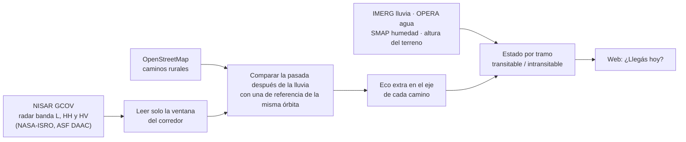
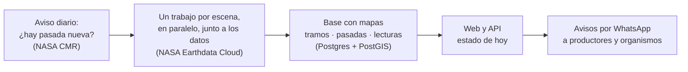
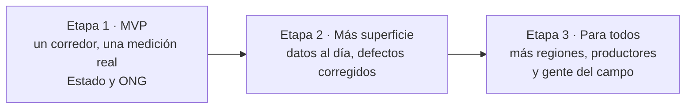

# BAQUI · El estado de los caminos rurales, visto desde el satélite

> **NASA Space Apps Challenge 2026** · Desafío *Dancing with the SARs* · Sede General San Martín, Chaco (Argentina)
>
> **Web:** [baqui-nasa.vercel.app](https://baqui-nasa.vercel.app) · **English:** [README.md](README.md)

> [!NOTE]
> **Prototipo.** **Real:** la medición del radar NISAR (NASA-ISRO) sobre 1.201,7 km de caminos rurales sin pavimento del corredor de General San Martín, Chaco. **Simulado:** el agua de la demo (sección 4) y la consola de despacho (sección 2). La web marca qué es cada cosa.

BAQUI responde una sola pregunta: **¿el camino rural está transitable después de la lluvia?** Usa el radar NISAR de NASA, que ve a través de las nubes, para que nadie tenga que ir hasta el camino a mirar.

---

## Contenido

1. [El problema](#1-el-problema)
2. [Qué hace BAQUI](#2-qué-hace-baqui)
3. [Cómo funciona](#3-cómo-funciona)
4. [Datos de NASA que usamos](#4-datos-de-nasa-que-usamos)
5. [Resultado real](#5-resultado-real)
6. [La web, sección por sección](#6-la-web-sección-por-sección)
7. [Cómo correrlo](#7-cómo-correrlo)
8. [Estructura del repo](#8-estructura-del-repo)
9. [Real y simulado](#9-real-y-simulado)
10. [Límites](#10-límites)
11. [Camino a producción y escala](#11-camino-a-producción-y-escala)
12. [Hoja de ruta](#12-hoja-de-ruta)
13. [Uso de IA](#13-uso-de-ia)
14. [Créditos y licencia](#14-créditos-y-licencia)

---

## 1. El problema

Cuando llueve en el campo, los caminos de tierra se cortan. Cruz Roja, Protección Civil, Cáritas, Vialidad y los productores **salen sin saber si el camino da paso**: despachan a ciegas, arriesgan vehículos y pierden tiempo y plata.

Justo cuando más llueve hay nubes, y los satélites que sacan "fotos" comunes no ven nada. Con El Niño, que puede intensificarse hacia fin de año y comienzos del próximo, el problema crece.

## 2. Qué hace BAQUI

| Para quién | Qué pregunta | Qué responde |
|---|---|---|
| Organismos del Estado y ONG (Protección Civil, Vialidad, Cruz Roja, Cáritas) y productores | "¿Llego hoy a este lugar?" | Si el camino está **transitable o intransitable**, tramo por tramo, con el dato del radar que lo respalda |

## 3. Cómo funciona

El radar NISAR manda una señal de radio hacia la tierra y escucha cuánto rebota (el **eco**). La señal atraviesa nubes y funciona de noche. El agua cambia el eco:

| Suelo | Qué pasa | Eco |
|---|---|---|
| **Seco** | Tierra firme | Normal |
| **Mojado** | Sin agua encima: la tierra mojada devuelve más señal | **Sube** |
| **Bajo agua** | El agua cubre el suelo y hace de espejo | **Cae** |



Paso a paso:

1. **Buscar las pasadas** de NISAR sobre la zona con la herramienta oficial de NASA (`earthaccess`, NASA Earthdata).
2. **Leer solo el corredor.** No se baja la escena entera (unos 1,8 GB): se lee por internet la ventana que importa (unos 43 MB).
3. **Ubicar los caminos** con OpenStreetMap y medir solo el centro de cada uno (píxeles a 10 m o menos del eje).
4. **Comparar** una pasada después de la lluvia con otra de referencia de la **misma órbita**, así el satélite mira desde el mismo ángulo. La diferencia es el eco extra.
5. **Clasificar** cada tramo sumando la lluvia (IMERG), el agua en superficie (OPERA), la humedad del suelo (SMAP) y si el tramo está en un bajo o en una loma (altura del terreno).

El detalle está en [`analisis/docs/HIPOTESIS-FISICA.md`](analisis/docs/HIPOTESIS-FISICA.md) y [`analisis/docs/ALGORITMO-BAQUI.md`](analisis/docs/ALGORITMO-BAQUI.md).

## 4. Datos de NASA que usamos

| Dato | Fuente | Para qué | En el prototipo |
|---|---|---|---|
| **NISAR L2 GCOV** (banda L, HH y HV) | NASA-ISRO, vía ASF DAAC | Eco del radar sobre los caminos | **Medido** (números de la sección 5) |
| **IMERG** (lluvia diaria) | NASA GPM | Lluvia desde la pasada, por tramo | Bajado y usado en el algoritmo |
| **OPERA DSWx-S1** (agua en superficie) | NASA JPL | Control: dónde hay agua a la vista | Usado en los chequeos |
| **SMAP** (humedad del suelo) | NASA | Humedad de la zona | Bajado |
| **Blue Marble** | NASA | Imagen de la Tierra en el globo 3D | En la web |
| Copernicus DEM GLO-30 | ESA (no es de NASA) | Altura del terreno: bajo o loma | Bajado |
| OpenStreetMap | Comunidad OSM | Los caminos | Real |

Todos los datos son públicos y gratis. No están en el repo porque pesan varios GB: se bajan con los scripts de [`analisis/`](analisis/README.md).

## 5. Resultado real

Corredor de General San Martín (Chaco), órbita 161 ascendente, frame 164. Una pasada después de la lluvia contra otra de referencia de la misma órbita.

| Medición | Valor | Qué significa |
|---|---|---|
| Eco extra en el eje de los caminos (mediana, HH) | **+1,35 dB** | El suelo se mojó |
| Puntos del camino con más de 1 dB extra | **6 de cada 10** | No es un caso aislado |
| Sin monte: eje del camino contra campo abierto | **+1,63 dB contra +1,57 dB** | Se mojó toda la zona, no solo el camino |
| Puntos con agua abierta nueva | **3 de 53.611 (0,006 %)** | Mojado, no bajo agua |
| Caminos medidos | **1.201,7 km** | Caminos rurales sin pavimento de OpenStreetMap |

**Conclusión:** el radar ve la **zona mojada**. Cada número tiene anotado su archivo de origen en [`web/src/data/resultados.json`](web/src/data/resultados.json) (campos `_fuente`). Cualquiera lo puede verificar gratis en [ASF Vertex](https://search.asf.alaska.edu/) con el ID del archivo que da la web.

## 6. La web, sección por sección

| # | Sección | Qué muestra | Carpeta |
|---|---|---|---|
| 1 | Qué es BAQUI | Globo 3D con NISAR en su órbita real (TLE de Celestrak propagado con `satellite.js`) | [`web/src/views/1-visor/`](web/src/views/1-visor/) |
| 2 | El problema | Quién sufre el camino cortado y la consola de despacho (escena ilustrativa) | [`web/src/views/2-operaciones/`](web/src/views/2-operaciones/) |
| 3 | Por qué ahora: El Niño | Salud, logística, tiempo y dinero | [`web/src/views/3-impacto/`](web/src/views/3-impacto/) |
| 4 | La demo: ¿llegás hoy? | Elegís un destino y BAQUI responde si llegás, sobre caminos reales con agua simulada | [`web/src/views/4-demo/`](web/src/views/4-demo/) |
| 5 | Cómo lo sabe BAQUI | Hipótesis física y la medición real de NISAR | [`web/src/views/5-resultados/`](web/src/views/5-resultados/) |

Todos los textos de cada sección están en su archivo `textos.ts`.

## 7. Cómo correrlo

**Web** (Next.js 16, React 19, TypeScript, Tailwind 4, three.js, Leaflet):

```bash
cd web
pnpm install
pnpm dev        # http://localhost:3000
```

**Análisis** (Python):

```bash
cd analisis
pip install -r requirements.txt
python -m pytest -q tests   # 53 tests, no necesitan los datos
```

Para bajar los datos de NASA hace falta una cuenta gratis de [NASA Earthdata](https://urs.earthdata.nasa.gov/). Los comandos están en [`analisis/README.md`](analisis/README.md).

## 8. Estructura del repo

```
baqui-space-app/
├── web/                    La página (Next.js)
│   ├── src/views/          Una carpeta por sección (1 a 5), cada una con su textos.ts
│   ├── src/data/           resultados.json: los números reales con su fuente
│   └── public/             Imágenes
├── analisis/               La ciencia (Python)
│   ├── baqui/              Descarga, medición, clasificación, lluvia y secado
│   ├── baqui/chequeos/     Controles que generan los números de la web
│   ├── tests/              53 tests
│   └── docs/               Hipótesis física, algoritmo y reglas del estado de cada tramo
└── docs/                   Guion del pitch y del video
```

## 9. Real y simulado

| Real | Simulado o ilustrativo |
|---|---|
| Datos de NISAR y la medición de la sección 5 | El agua de la demo (sección 4) |
| Caminos y lugares de OpenStreetMap | La consola de despacho (sección 2) |
| La órbita de NISAR en el globo | La foto del pie de página: es de Veracruz, México, no del corredor medido |
| Imagen de la Tierra (NASA Blue Marble) | |

## 10. Límites

- **El radar mide la zona, no solo el camino.** A esta resolución el camino y el campo de alrededor suben casi igual. Por eso decimos "zona mojada".
- **Bajo el monte no se confirma agua.** El 38,1 % del eje de los caminos tiene monte.
- **Es una sola comparación** (un par de pasadas). Falta validarlo en el terreno.
- **El estado por tramo y el secado día a día están programados pero no calibrados.** La demo usa agua simulada.
- **Frecuencia:** NISAR repite órbita cada 12 días. Sobre el corredor pasaron 3 órbitas distintas en 12 días, así que hay un dato nuevo cada unos 4 días.
- **Los productos de NISAR son provisionales** y hoy se publican con atraso.

## 11. Camino a producción y escala

**La idea central: NASA guarda las imágenes, BAQUI guarda solo la respuesta.**

| Qué | Tamaño | Cómo lo sabemos |
|---|---|---|
| Una escena completa de NISAR | ~1,8 GB | Medido |
| La ventana del corredor que leemos | ~43 MB | Medido (ya funciona así) |
| El resultado de una pasada (unos 12.000 tramos de 100 m) | menos de 1 MB | Estimado |

Más de 2.000 veces menos de lo que hay que guardar. Con unas 90 pasadas por año sobre el corredor, la base crece unos 70 a 80 MB por año. Para 100.000 km de caminos, lo que se consulta (el estado de hoy, una fila por tramo) ocupa unos 60 MB, y el historial va a un almacenamiento barato.

Arquitectura propuesta:



Cada lectura guarda el ID del archivo de NASA, así cualquiera puede rehacer el cálculo.

## 12. Hoja de ruta



### Etapa 1 · MVP (hecha, Space Apps 2026)

- Medición real de NISAR sobre **1.201,7 km** de caminos rurales del corredor de General San Martín (Chaco): **+1,35 dB**, zona mojada.
- La hipótesis física probada en una comparación (pasada después de la lluvia contra una de referencia de la misma órbita).
- Web con la demo "¿Llegás hoy?" sobre caminos reales (agua simulada), verificable gratis en ASF Vertex.
- Algoritmo programado: estado por tramo, lluvia desde la pasada (IMERG) y secado. 53 tests.
- Público: organismos del Estado y ONG.

### Etapa 2 · Más superficie, datos al día y defectos corregidos

- **Más superficie:** del corredor a toda la provincia del Chaco y después al NEA.
- **Datos al día, solos:** un aviso diario busca pasadas nuevas de NISAR y las procesa sin intervención (arquitectura de la [sección 11](#11-camino-a-producción-y-escala)). La lluvia (IMERG) y la humedad (SMAP) actualizan el estado todos los días entre pasadas.
- **Más pasadas:** sumar SAOCOM (radar argentino de CONAE, banda L como NISAR) y Sentinel-1 / OPERA para tener un dato del camino más seguido, y CYGNSS (NASA) para saber casi a diario si la zona se mojó.
- **Defectos a corregir** (ver [Límites](#10-límites)):
  - Calibrar el estado por tramo y el secado con muchas pasadas, no con una.
  - Validar en el terreno con Vialidad, Protección Civil y productores: fotos del camino el mismo día de la pasada.
  - Medir tramo por tramo (cada 100 m) y separar mejor el camino del campo, usando las dos polarizaciones (HH y HV).
  - Bajo el monte: confirmar el agua con otras fuentes.
  - Reemplazar el agua simulada de la demo por la medición real.
- **Web en inglés y en español.**

### Etapa 3 · Más regiones y más gente

- **Más superficie:** el resto de Argentina y otros países con caminos de tierra y temporadas de lluvia. NISAR cubre todo el planeta.
- **Más público:** productores rurales, trabajadores del campo, transportistas, escuelas rurales y cualquier persona que tenga que salir por un camino de tierra.
- **Donde la gente ya está:** consulta y avisos por WhatsApp ("¿llego hoy a…?"), un mapa público y una API para Vialidad, Protección Civil y las ONG.
- **La meta:** que no se pierda producción, plata ni tiempo, y que las ambulancias y las donaciones lleguen a tiempo. Para comprobar que se cumple, medimos cuántas respuestas acierta BAQUI contra lo que se ve en el terreno, y cuánto tiempo ahorran los despachos.

## 13. Uso de IA

Las reglas de Space Apps 2026 piden contar cómo usamos la IA.

| Herramienta | Para qué |
|---|---|
| **Claude Code** (Anthropic) | Escribió la mayor parte del código: la web (Next.js, globo con three.js, demo con Leaflet), los scripts de Python que bajan y miden NISAR y los documentos técnicos. Sus commits llevan `Co-Authored-By: Claude`. |
| **Varios agentes de Claude** | Revisaron el diseño y la exactitud de los textos. Cada problema lo confirmaba un segundo agente antes de aplicar el cambio. |
| **Modelos gratuitos** (vía FreeLLMAPI) | Leer y resumir fuentes públicas. Nunca recibieron datos privados. |

**Qué hizo el equipo:** eligió el desafío, la idea y a quién le sirve; aprobó cada texto y cada cambio de diseño; pidió que cada número se cotejara contra su archivo de origen y que cada fuente se abriera antes de citarla.

**Qué no sale de la IA:** los números (salen de correr nuestros scripts sobre datos reales de NASA), la imagen de la Tierra (NASA Blue Marble), la foto del pie de página (foto real de Wikimedia Commons) y los caminos (OpenStreetMap). No hay imágenes generadas con IA.

## 14. Créditos y licencia

- **Código:** licencia [MIT](LICENSE).
- **Datos:** NASA (NISAR con ISRO, IMERG, OPERA, SMAP, Blue Marble), datos públicos. Copernicus DEM GLO-30 de la ESA.
- **Caminos:** © colaboradores de [OpenStreetMap](https://www.openstreetmap.org/copyright), licencia ODbL.
- **Foto del pie de página:** "Camino inundado en Salinas, Alvarado, Veracruz 01", de Isaacvp, [Wikimedia Commons](https://commons.wikimedia.org/wiki/File:Camino_inundado_en_Salinas,_Alvarado,_Veracruz_01.jpg), licencia CC BY-SA 4.0. Adaptada (recorte y tono), con la misma licencia.
- BAQUI no está afiliado a NASA ni la representa.
