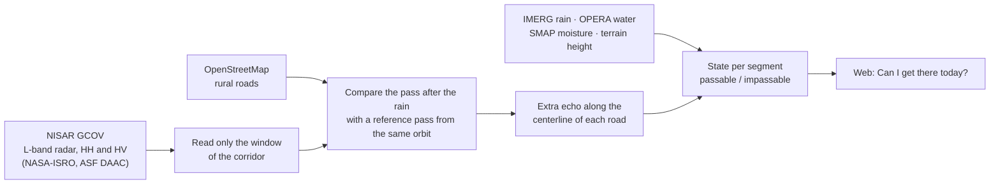
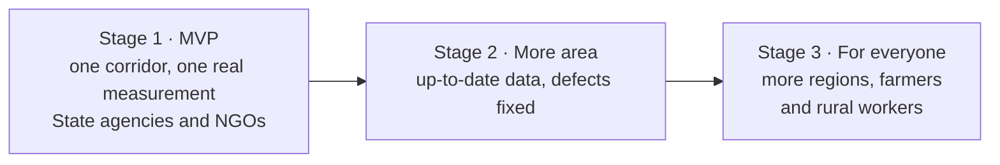

# BAQUI · The state of rural roads, seen from space

> **NASA Space Apps Challenge 2026** · Challenge *Dancing with the SARs* · Host city General San Martín, Chaco (Argentina)
>
> **Web:** [baqui-nasa.vercel.app](https://baqui-nasa.vercel.app) · **Español:** [README.es.md](README.es.md)

> [!NOTE]
> **Prototype.** **Real:** the NISAR (NASA-ISRO) radar measurement over 1,201.7 km of unpaved rural roads in the General San Martín corridor, Chaco. **Simulated:** the water in the demo (section 4) and the dispatch console (section 2). The web marks which is which.

BAQUI answers a single question: **is the rural road passable after the rain?** It uses NASA's NISAR radar, which sees through clouds, so that nobody has to go to the road to look.

---

## Contents

1. [The problem](#1-the-problem)
2. [What BAQUI does](#2-what-baqui-does)
3. [How it works](#3-how-it-works)
4. [NASA data we use](#4-nasa-data-we-use)
5. [Real result](#5-real-result)
6. [The web, section by section](#6-the-web-section-by-section)
7. [How to run it](#7-how-to-run-it)
8. [Repo structure](#8-repo-structure)
9. [Real and simulated](#9-real-and-simulated)
10. [Limits](#10-limits)
11. [Path to production and scale](#11-path-to-production-and-scale)
12. [Roadmap](#12-roadmap)
13. [Use of AI](#13-use-of-ai)
14. [Credits and license](#14-credits-and-license)

---

## 1. The problem

When it rains in the countryside, dirt roads get cut off. Red Cross, Civil Protection, Cáritas, the roads agency (Vialidad) and farmers **set out without knowing whether the road can be crossed**: they dispatch blindly, risk vehicles and lose time and money.

Heavy rain comes with clouds, and satellites that take ordinary "photos" see nothing. With El Niño, which may intensify toward the end of the year and the start of the next, the problem grows.

## 2. What BAQUI does

| For whom | What question | What it answers |
|---|---|---|
| State agencies and NGOs (Civil Protection, Vialidad, Red Cross, Cáritas) and farmers | "Can I get there today?" | Whether the road is **passable or impassable**, segment by segment, with the radar data behind it |

## 3. How it works

The NISAR radar sends a radio signal toward the ground and listens to how much bounces back (the **echo**). The signal goes through clouds and works at night. Water changes the echo:

| Ground | What happens | Echo |
|---|---|---|
| **Dry** | Firm ground | Normal |
| **Wet** | No standing water: wet soil returns more signal | **Rises** |
| **Under water** | Water covers the ground and acts as a mirror | **Drops** |



Step by step:

1. **Find the passes** of NISAR over the area with NASA's official tool (`earthaccess`, NASA Earthdata).
2. **Read only the corridor.** The whole scene (about 1.8 GB) is not downloaded: the window that matters (about 43 MB) is read over the internet.
3. **Locate the roads** with OpenStreetMap and measure only the center of each one (pixels within 10 m of the centerline).
4. **Compare** a pass after the rain with a reference pass from the **same orbit**, so the satellite looks from the same angle. The difference is the extra echo.
5. **Classify** each segment by adding rainfall (IMERG), surface water (OPERA), soil moisture (SMAP) and whether the segment lies in a low spot or on a rise (terrain height).

The details are in [`analisis/docs/HIPOTESIS-FISICA.md`](analisis/docs/HIPOTESIS-FISICA.md) and [`analisis/docs/ALGORITMO-BAQUI.md`](analisis/docs/ALGORITMO-BAQUI.md).

## 4. NASA data we use

| Data | Source | Used for | In the prototype |
|---|---|---|---|
| **NISAR L2 GCOV** (L-band, HH and HV) | NASA-ISRO, via ASF DAAC | Radar echo over the roads | **Measured** (numbers in section 5) |
| **IMERG** (daily rainfall) | NASA GPM | Rainfall since the pass, per segment | Downloaded and used in the algorithm |
| **OPERA DSWx-S1** (surface water) | NASA JPL | Control: where water is visible | Used in the checks |
| **SMAP** (soil moisture) | NASA | Moisture of the area | Downloaded |
| **Blue Marble** | NASA | Image of the Earth on the 3D globe | On the web |
| Copernicus DEM GLO-30 | ESA (not NASA) | Terrain height: low spot or rise | Downloaded |
| OpenStreetMap | OSM community | The roads | Real |

All data are public and free. They are not in the repo because they weigh several GB: they are downloaded with the scripts in [`analisis/`](analisis/README.md).

## 5. Real result

General San Martín corridor (Chaco), ascending orbit 161, frame 164. A pass after the rain against a reference pass from the same orbit.

| Measurement | Value | What it means |
|---|---|---|
| Extra echo along the road centerline (median, HH) | **+1.35 dB** | The ground got wet |
| Road points with more than 1 dB extra | **6 out of 10** | Not an isolated case |
| Without forest: road centerline against open field | **+1.63 dB vs +1.57 dB** | The whole area got wet, not just the road |
| Points with new open water | **3 of 53,611 (0.006%)** | Wet, not under water |
| Roads measured | **1,201.7 km** | Unpaved rural roads from OpenStreetMap |

**Conclusion:** the radar sees the **wet area**. Each number has its source file noted in [`web/src/data/resultados.json`](web/src/data/resultados.json) (`_fuente` fields). Anyone can verify it for free in [ASF Vertex](https://search.asf.alaska.edu/) with the file ID given by the web.

## 6. The web, section by section

| # | Section | What it shows | Folder |
|---|---|---|---|
| 1 | What BAQUI is | 3D globe with NISAR in its real orbit (Celestrak TLE propagated with `satellite.js`) | [`web/src/views/1-visor/`](web/src/views/1-visor/) |
| 2 | The problem | Who suffers from the cut road, and the dispatch console (illustrative scene) | [`web/src/views/2-operaciones/`](web/src/views/2-operaciones/) |
| 3 | Why now: El Niño | Health, logistics, time and money | [`web/src/views/3-impacto/`](web/src/views/3-impacto/) |
| 4 | The demo: will you get there today? (¿Llegás hoy?) | You pick a destination and BAQUI answers whether you can get there, on real roads with simulated water | [`web/src/views/4-demo/`](web/src/views/4-demo/) |
| 5 | How BAQUI knows | Physical hypothesis and the real NISAR measurement | [`web/src/views/5-resultados/`](web/src/views/5-resultados/) |

All the texts of each section are in its `textos.ts` file.

## 7. How to run it

**Web** (Next.js 16, React 19, TypeScript, Tailwind 4, three.js, Leaflet):

```bash
cd web
pnpm install
pnpm dev        # http://localhost:3000
```

**Analysis** (Python):

```bash
cd analisis
pip install -r requirements.txt
python -m pytest -q tests   # 53 tests, they do not need the data
```

To download the NASA data you need a free [NASA Earthdata](https://urs.earthdata.nasa.gov/) account. The commands are in [`analisis/README.md`](analisis/README.md).

## 8. Repo structure

```
baqui-space-app/
├── web/                    The page (Next.js)
│   ├── src/views/          One folder per section (1 to 5), each with its textos.ts
│   ├── src/data/           resultados.json: the real numbers with their source
│   └── public/             Images
├── analisis/               The science (Python)
│   ├── baqui/              Download, measurement, classification, rainfall and drying
│   ├── baqui/chequeos/     Checks that generate the numbers on the web
│   ├── tests/              53 tests
│   └── docs/               Physical hypothesis, algorithm and rules for the state of each segment
└── docs/                   Pitch and video script
```

## 9. Real and simulated

| Real | Simulated or illustrative |
|---|---|
| NISAR data and the measurement in section 5 | The water in the demo (section 4) |
| Roads and places from OpenStreetMap | The dispatch console (section 2) |
| The NISAR orbit on the globe | The footer photo: it is from Veracruz, Mexico, not from the measured corridor |
| Image of the Earth (NASA Blue Marble) | |

## 10. Limits

- **The radar measures the area, not just the road.** At this resolution the road and the surrounding field rise almost equally. That is why we say "wet area".
- **Water under forest is not confirmed.** 38.1% of the road centerline has forest.
- **It is a single comparison** (one pair of passes). It still needs validation on the ground.
- **The state per segment and the day-by-day drying are programmed but not calibrated.** The demo uses simulated water.
- **Frequency:** NISAR repeats its orbit every 12 days. Over the corridor, 3 different orbits passed in 12 days, so there is new data about every 4 days.
- **NISAR products are provisional** and are currently published with a delay.

## 11. Path to production and scale

**The central idea: NASA stores the images, BAQUI stores only the answer.**

| What | Size | How we know |
|---|---|---|
| A full NISAR scene | ~1.8 GB | Measured |
| The corridor window we read | ~43 MB | Measured (it already works this way) |
| The result of one pass (about 12,000 segments of 100 m) | under 1 MB | Estimated |

More than 2,000 times less than what would have to be stored. With about 90 passes per year over the corridor, the database grows about 70 to 80 MB per year. For 100,000 km of roads, what is queried (today's state, one row per segment) takes about 60 MB, and the history goes to cheap storage.

Proposed architecture:


Each reading stores the ID of the NASA file, so anyone can redo the calculation.

## 12. Roadmap



### Stage 1 · MVP (done, Space Apps 2026)

- Real NISAR measurement over **1,201.7 km** of rural roads in the General San Martín corridor (Chaco): **+1.35 dB**, wet area.
- The physical hypothesis tested in one comparison (a pass after the rain against a reference pass from the same orbit).
- Web with the "Will you get there today?" demo on real roads (simulated water), verifiable for free in ASF Vertex.
- Algorithm programmed: state per segment, rainfall since the pass (IMERG) and drying. 53 tests.
- Audience: State agencies and NGOs.

### Stage 2 · More area, up-to-date data and defects fixed

- **More area:** from the corridor to the whole province of Chaco, then to Northeast Argentina.
- **Data kept up to date automatically:** a daily check finds new NISAR passes and processes them with no manual step (architecture in [section 11](#11-path-to-production-and-scale)). Rainfall (IMERG) and soil moisture (SMAP) update the state every day between passes.
- **More passes:** add SAOCOM (Argentina's CONAE radar, L-band like NISAR) and Sentinel-1 / OPERA to get road data more often, and CYGNSS (NASA) to know almost daily whether the area got wet.
- **Defects to fix** (see [Limits](#10-limits)):
  - Calibrate the state per segment and the drying with many passes, not one.
  - Validate on the ground with the roads agency, Civil Protection and farmers: photos of the road on the day of the pass.
  - Measure segment by segment (every 100 m) and better separate the road from the field, using both polarizations (HH and HV).
  - Under forest: confirm water with other sources.
  - Replace the simulated water in the demo with the real measurement.
- **Web in English and Spanish.**

### Stage 3 · More regions and more people

- **More area:** the rest of Argentina and other countries with dirt roads and rainy seasons. NISAR covers the whole planet.
- **Wider audience:** farmers, rural workers, truck drivers, rural schools and anyone who has to travel on a dirt road.
- **Where people already are:** queries and alerts over WhatsApp ("can I get to … today?"), a public map and an API for the roads agency, Civil Protection and NGOs.
- **The goal:** no lost production, money or time, and ambulances and donations that arrive on time. To check that it works, we measure how many BAQUI answers match what is seen on the ground, and how much time dispatches save.

## 13. Use of AI

The Space Apps 2026 rules ask us to state how we used AI.

| Tool | Used for |
|---|---|
| **Claude Code** (Anthropic) | Wrote most of the code: the web (Next.js, three.js globe, Leaflet demo), the Python scripts that download and measure NISAR, and the technical documents. Its commits carry `Co-Authored-By: Claude`. |
| **Several Claude agents** | Reviewed the design and the accuracy of the texts. Each problem was confirmed by a second agent before the change was applied. |
| **Free models** (via FreeLLMAPI) | Reading and summarizing public sources. They never received private data. |

**What the team did:** chose the challenge, the idea and who it serves; approved every text and every design change; asked that every number be checked against its source file and that every source be opened before citing it.

**What does not come from AI:** the numbers (they come from running our scripts on real NASA data), the image of the Earth (NASA Blue Marble), the footer photo (a real photo from Wikimedia Commons) and the roads (OpenStreetMap). There are no AI-generated images.

## 14. Credits and license

- **Code:** [MIT](LICENSE) license.
- **Data:** NASA (NISAR with ISRO, IMERG, OPERA, SMAP, Blue Marble), public data. Copernicus DEM GLO-30 from ESA.
- **Roads:** © [OpenStreetMap](https://www.openstreetmap.org/copyright) contributors, ODbL license.
- **Footer photo:** "Camino inundado en Salinas, Alvarado, Veracruz 01", by Isaacvp, [Wikimedia Commons](https://commons.wikimedia.org/wiki/File:Camino_inundado_en_Salinas,_Alvarado,_Veracruz_01.jpg), CC BY-SA 4.0 license. Adapted (crop and tone), under the same license.
- BAQUI is not affiliated with NASA and does not represent it.
